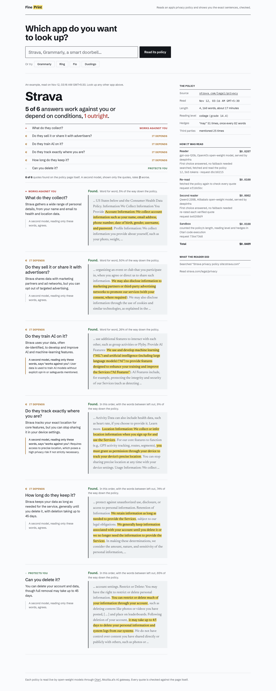

# Fine Print

Name an app. Fine Print reads its privacy policy and answers six questions a person actually asks: what they collect, whether they sell it, whether they train AI on it, whether they track where you are, how long they keep it, and whether you can delete it.

Every answer sits beside the policy's own sentence, shown in its place on the page. The server reads the page a second time and checks each quote against it. A quote found on the page is highlighted. A quote the model reworded is struck through and called out, so a model's paraphrase never passes as the company's words.



## How one review runs, all through Otari

| Step | Otari feature | What happens |
|---|---|---|
| Find and read | `otari_web_search`, `otari_web_fetch`, streamed | An open-weight reader (`openai/gpt-oss-120b`) searches for the official, current policy, fetches it and answers in JSON. The page shows each search and fetch as Otari reports it. |
| Check | `POST /v1/fetch` | The server fetches the same page and locates every quote in it, across markdown, line breaks, curly quotes and hyphens. Excerpts joined with `...` must appear piece by piece, in page order. |
| Re-quote | chat completion, JSON mode | Quotes not on the page go back to the reader with the page text in hand. A new quote is checked again before it is shown, and the reworded first attempt stays visible, struck through. |
| Second opinion | a second open-weight model | `alibaba/qwen3-235b-a22b-instruct-2507` rates each verified quote without seeing the first rating. Where the two disagree, the page says so and gives its reason. |
| Measure | `POST /v1/code/execute` | Python in Otari's sandbox counts the policy's words, reading time, reading grade, and how often it says "may" or mentions third parties. |
| Pay | `GET /v1/key/budget`, `usage.cost_usd`, `/v1/usage/requests/{id}` | A review starts only when the key has budget left. The rail itemises every step: model, provider, fallback, tokens, request id and cost. |

Three more gateway features switch on from `.env`:

- **Routing and fallbacks:** set `OTARI_MODEL` to a routing policy name. The rail reads `Otari-Fallback` and `Otari-Attempt-Count` and shows when a fallback served the request.
- **Per-visitor budgets:** set `OTARI_SERVICE_KEY` to a service key. Each visitor gets a stable cookie id, sent as the Otari end user, so each person spends from their own budget.
- **Guardrails:** set `OTARI_GUARDRAIL_PROFILE`. Every page the reader fetches passes that guardrail, in block mode on `tool_results`, before the model reads it.

## Measured on Strava's policy

From the saved run in `examples/strava.json`, read through Otari on 2026-11-11:

- 6 of 6 quotes found on strava.com/legal/privacy
- the policy runs 4,160 words, a 17-minute read at reading grade 14.4, with "may" 51 times
- the second model rated 2 of the 6 answers worse than the reader did
- the whole review cost $0.0409 across four Otari steps

The second reader's independence is tested, not assumed. `check-live.mjs` plants two wrong ratings and passes only when the second model overrules both.

## Run it

Node 22 or later, no dependencies.

```bash
cp .env.example .env    # add OTARI_API_KEY from otari.ai
node server.mjs         # http://localhost:3000
```

In the otari.ai dashboard, turn on **Tools → Web search** for the key's workspace (it covers search and fetch) and code execution.

## Checks

```bash
node test.mjs                        # quote matching, offline
node --env-file=.env check-live.mjs  # fetch, sandbox and second reader against Otari
```

`test.mjs` covers verbatim quotes across markdown and line breaks, excerpts joined with `...`, pieces out of order, a tampered number, a paraphrase, a flipped meaning, and that an excerpt highlights only its quoted pieces.
